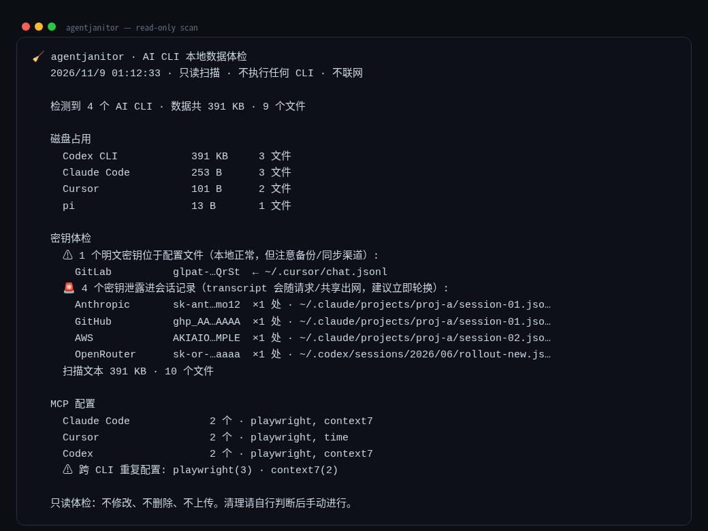

<div align="center">

# 🧹 agentjanitor

**Fourteen AI CLIs live on your disk. Do you know what they left there?**

[](https://github.com/ecoreal/agentjanitor/actions/workflows/ci.yml)
[](LICENSE)
[](package.json)
[](package.json)
[](#development)

[中文说明](README.zh-CN.md)

One read-only command. Four answers:

- **Disk** — which CLI eats how much, and what is stale enough to clean
- **Keys in configs** — every plaintext API key sitting in CLI config files (masked, counted, located)
- **Keys in transcripts** — 🚨 secrets that leaked INTO session logs and will travel with every share, backup or sync
- **MCP sprawl** — which MCP servers are configured where, and which are duplicated across CLIs



</div>

## Install

```bash
npm install -g agentjanitor
# or run once, install nothing:
npx agentjanitor
```

Requires Node ≥ 18.17. Zero dependencies.

## What it scans

Claude Code · Codex CLI · pi · Cursor · OpenCode · Gemini CLI · Copilot CLI ·
OpenClaw · Windsurf · Continue · Aider · Qwen Code · Droid · Goose — detection
is directory-based, so unknown-but-present CLIs in the registry are picked up
without any process being launched.

Secret patterns: Anthropic, OpenAI, DeepSeek, GitHub (token + PAT), AWS,
Slack, GitLab, Google, Groq, OpenRouter, Moonshot.

```bash
agentjanitor                 # the full report (read-only)
agentjanitor --json          # machine-readable, for CI / cron
agentjanitor --no-secrets    # disk only
agentjanitor --stale-days 30 # stricter cleanup candidates

# The only deleting path: dry-run preview first, then --yes to execute
agentjanitor clean            # preview what would go (deletes nothing)
agentjanitor clean --yes      # actually remove the stale files
```

## The read-only guarantees

- No AI CLI is launched. No config is written. No file is deleted.
- Nothing leaves your machine: no network requests at all.
- Secrets are shown **masked** (`sk-ant…9f2a` — 6 head + 4 tail chars); full
  values never reach the terminal, JSON, or your clipboard.
- `node_modules` is never traversed; scan totals are capped (300 MB/CLI,
  5 MB/file) so the command finishes in seconds, not minutes.

## Why not just...?

| alternative | the gap |
|---|---|
| `ccusage` | usage & cost only — no disk, no secrets, no config |
| `claude-clean` | disk only, Claude Code only |
| TruffleHog / Gitleaks | repo-focused, heavyweight config; not tuned for AI CLI local layouts |
| each CLI's own `/mcp` | per-CLI view; no cross-CLI duplicates, no security audit |

## Development

```bash
git clone https://github.com/ecoreal/agentjanitor && cd agentjanitor
npm test          # 31 tests against synthetic fixtures — never touches your real home
```

CI runs the matrix on Ubuntu/macOS/Windows × Node 18/20/22/24.

## Roadmap

- [x] `clean` — dry-run preview + explicit `--yes` execution
- [ ] OpenClaw plugin context-cost estimate
- [ ] `--watch` mode for timer-based drift reports

## License

MIT © 2026 [Jerry Lee (ecoreal)](https://github.com/ecoreal)
