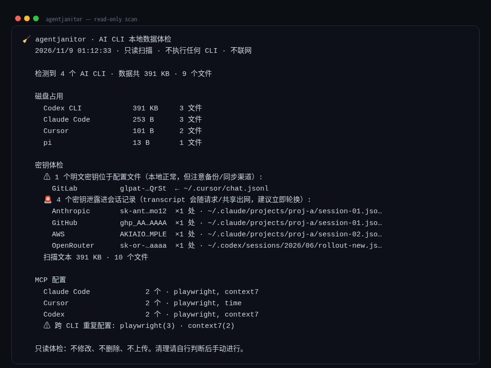

<div align="center">

# 🧹 agentjanitor

**你的盘上住着十四个 AI CLI。它们留下了什么，你知道吗？**

[](https://github.com/ecoreal/agentjanitor/actions/workflows/ci.yml)
[](LICENSE)
[](package.json)
[](package.json)
[](#开发)

[English](README.md)

一条只读命令，四个答案：

- **磁盘** —— 哪个 CLI 吃了多少，什么旧到可以清了
- **配置里的明文密钥** —— 每个 CLI 配置文件里躺着的 API key（掩码显示、计数、定位）
- **transcript 里的泄密** —— 🚨 泄进会话记录的密钥，会随每次分享/备份/同步出网
- **MCP 摊大饼** —— MCP server 各自配在哪、哪些在多个 CLI 里重复



</div>

## 安装

```bash
npm install -g agentjanitor
# 或者不装，直接跑一次：
npx agentjanitor
```

需要 Node ≥ 18.17，**零依赖**。

## 扫描范围

Claude Code · Codex CLI · pi · Cursor · OpenCode · Gemini CLI · Copilot CLI ·
OpenClaw · Windsurf · Continue · Aider · Qwen Code · Droid · Goose —— 基于目录
探测，注册表里命中即列出，不启动任何进程。

密钥模式：Anthropic、OpenAI、DeepSeek、GitHub（token + PAT）、AWS、Slack、
GitLab、Google、Groq、OpenRouter、Moonshot。

```bash
agentjanitor                 # 完整体检（只读）
agentjanitor --json          # 机器可读，供 CI / 定时任务
agentjanitor --no-secrets    # 只看磁盘
agentjanitor --stale-days 30 # 更严格的可清理判定
```

## 只读保证

- 不启动任何 AI CLI。不写任何配置。不删任何文件。
- 什么都不出网：零网络请求。
- 密钥一律**掩码**显示（`sk-ant…9f2a`，前 6 后 4）；完整值不会出现在终端、JSON 或剪贴板。
- 永不遍历 `node_modules`；扫描有上限（每 CLI 300 MB、单文件 5 MB），秒级出结果。

## 为什么不用现成的？

| 现成方案 | 缺口 |
|---|---|
| `ccusage` | 只管用量和花费 —— 不管磁盘、密钥、配置 |
| `claude-clean` | 只管磁盘，只管 Claude Code |
| TruffleHog / Gitleaks | 面向仓库，配置重；不适配 AI CLI 的本地目录结构 |
| 各 CLI 自带的 `/mcp` | 单 CLI 视角；没有跨 CLI 重复检测，没有安全审计 |

## 开发

```bash
git clone https://github.com/ecoreal/agentjanitor && cd agentjanitor
npm test          # 26 个测试全部跑在合成 fixtures 上 —— 永不触碰你的真实 home
```

CI 矩阵：Ubuntu/macOS/Windows × Node 18/20/22/24。

## 路线图

- [ ] `--clean` 交互式清理（依然 opt-in，依然本地）
- [ ] OpenClaw 插件上下文开销估算
- [ ] `--watch` 定时漂移报告

## 许可

MIT © 2026 [Jerry Lee (ecoreal)](https://github.com/ecoreal)
